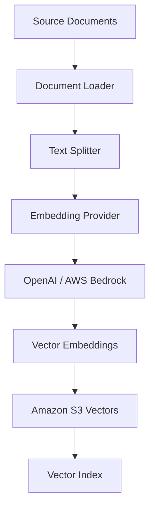
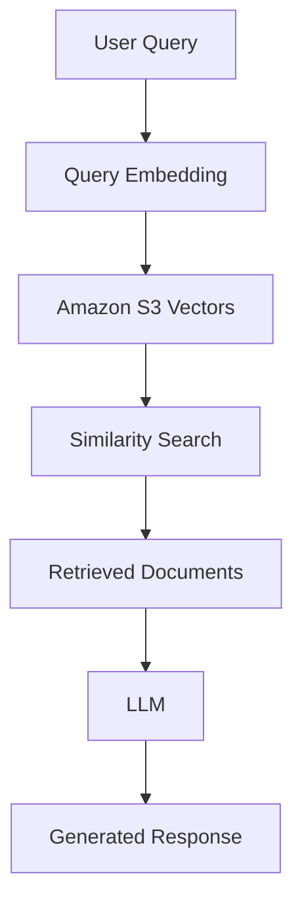

# AWS S3 Vectors as a Vector Database for GenAI Applications

## Overview

This project demonstrates how to use **AWS S3 Vector Bucket as a vector database** for building AI-powered applications.

It provides an end-to-end implementation of document ingestion, text chunking, embedding generation, vector storage, and semantic search using Amazon S3 Vectors.

The project explores integration with **OpenAI and AWS Bedrock embedding models**, demonstrating how S3 Vectors can be used as a vector storage and retrieval layer in Retrieval-Augmented Generation (RAG) applications.

## _Features_

- Create and configure an Amazon S3 Vector Bucket.
- Create and manage vector indexes.
- Load and process documents.
- Split documents into smaller chunks using text splitters.
- Generate vector embeddings using OpenAI embedding models.
- Integrate with AWS Bedrock embedding models.
- Store embeddings and associated metadata in S3 Vectors.
- Perform semantic similarity searches.
- Support metadata-based filtering.
- Build a foundation for RAG-based AI applications.

## Technology Stack

| Technology | Purpose |
|---|---|
| Python 3.x | Application development |
| Amazon S3 Vectors | Vector storage and retrieval |
| AWS Boto3 | AWS service integration |
| OpenAI | Embedding generation |
| AWS Bedrock | Embedding and foundation models |
| FastAPI | REST API development |
| LangChain | Document processing and embedding integration |
| LangGraph | Agentic AI workflows |
| UV | Python dependency and environment management |

## Architecture

The application follows a document ingestion and vector retrieval architecture.

### 1. Document Ingestion Workflow

1. Load documents from the configured data source.
2. Extract and preprocess document content.
3. Split documents into smaller chunks.
4. Generate embeddings using OpenAI or AWS Bedrock.
5. Store embeddings and associated metadata in Amazon S3 Vectors.



### 2. Vector Retrieval Workflow

1. Receive a user query.
2. Generate an embedding for the query.
3. Search for similar vectors in Amazon S3 Vectors.
4. Retrieve relevant document chunks and metadata.
5. Pass retrieved context to an LLM.
6. Generate a context-aware response.



## Project Structure

```text
s3-vectors-rag/
│
├── src/
│   ├── clients.py
│   ├── doc_loader.py
│   ├── embedding.py
│   ├── vector_store.py
│   └── main.py
│
├── data/
│   └── data.txt
│
├── scripts/
├── tests/
├── pyproject.toml
├── uv.lock
├── .env.example
└── README.md
```

## Getting Started

### Prerequisites

- Python 3.x
- UV package manager
- AWS account
- AWS CLI configured
- Amazon S3 Vectors bucket and vector index
- OpenAI API key or AWS Bedrock model access

### Installation

Clone the repository:

```bash
git clone <repository-url>
cd s3-vectors-rag
```

Install dependencies and create the virtual environment:

```bash
uv sync
```

Run the application:

```bash
uv run python -m src.main
```

### Configuration

Create a `.env` file using `.env.example` as a template.

```env
# AWS Configuration
AWS_REGION=us-east-1

# S3 Vectors Configuration
S3VECTOR_BUCKET_NAME=your-vector-bucket
S3VECTOR_INDEX_NAME=your-vector-index

# Embedding Provider
EMBEDDING_PROVIDER=openai

# OpenAI Configuration
OPENAI_API_KEY=your-openai-api-key
OPENAI_EMBEDDING_MODEL=text-embedding-3-small

# AWS Bedrock Configuration
BEDROCK_EMBEDDING_MODEL=your-bedrock-model-id
```

**AWS Authentication**

Use AWS IAM roles, AWS CLI profiles, or environment-based credentials to authenticate with AWS services.

Avoid committing credentials or sensitive configuration to the repository.

## Limitations and Considerations

Amazon S3 Vectors has specific capabilities and constraints that should be considered when designing AI applications.

- **Metadata limitations:** Filterable metadata has size and field constraints. Design metadata carefully to avoid exceeding service limits.
- **Embedding dimensions:** Vector dimensions must match the configured vector index.
- **Distance metrics:** Select an appropriate distance metric based on the embedding model and retrieval requirements.
- **Query performance:** Evaluate query latency and throughput for your workload.
- **Consistency:** Consider the consistency characteristics of vector operations when designing ingestion and retrieval workflows.
- **Filtering:** Design metadata to support efficient filtering during similarity searches.
- **Operational considerations:** Evaluate indexing, updates, deletion, and scaling requirements.

Refer to the official AWS documentation for the latest service limits and supported capabilities.

## Future Enhancements

- Implement a complete RAG pipeline.
- Expose semantic search through FastAPI.
- Integrate LangGraph for agentic retrieval workflows.
- Add document-level metadata filtering.
- Implement batch ingestion and incremental updates.
- Add retrieval evaluation and performance benchmarking.
- Add monitoring, logging, and error handling.
- Support additional embedding providers.

## References

- [Amazon S3 Vectors Documentation](https://docs.aws.amazon.com/AmazonS3/latest/userguide/s3-vectors.html)
- [Boto3 Documentation](https://boto3.amazonaws.com/v1/documentation/api/latest/index.html)
- [OpenAI API Documentation](https://platform.openai.com/docs)
- [Amazon Bedrock Documentation](https://docs.aws.amazon.com/bedrock/)
- [LangChain Documentation](https://python.langchain.com/docs/)
- [LangGraph Documentation](https://docs.langchain.com/oss/python/langgraph/overview)
- [UV Documentation](https://docs.astral.sh/uv/)

---

**Author:** Bharat Singh

**Focus:** AWS | GenAI | Vector Databases | RAG | Python
